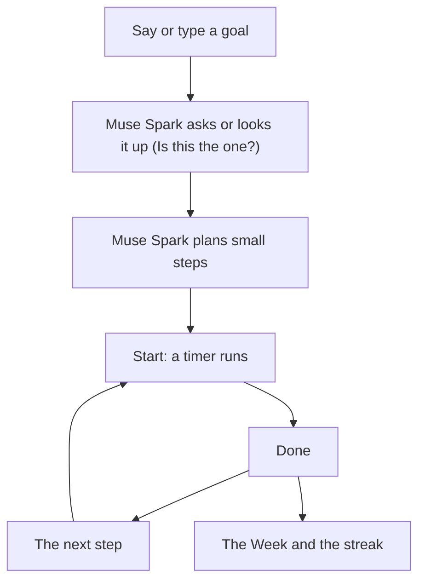
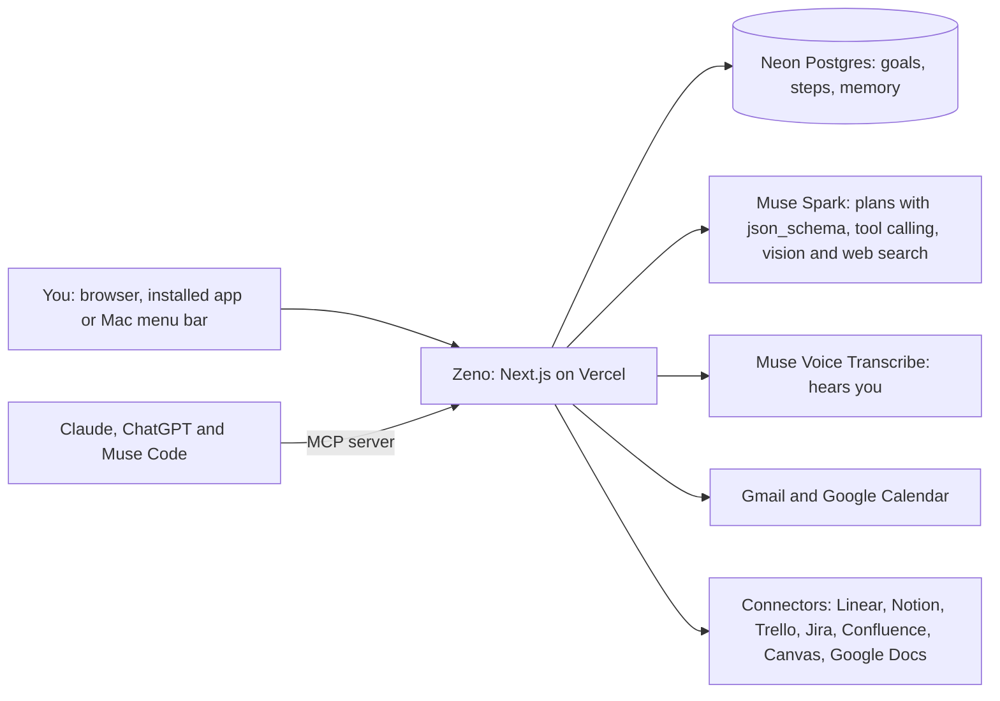

# Zeno

**Zeno turns what you mean to do into steps you can start now.**

**Live demo:** https://zeno-sigma-topaz.vercel.app
**Demo video:** (YouTube link)

Say a goal. Muse Spark splits it into small steps, most of 25 minutes or less, and Zeno stays with you while you do them.

## The problem

Most people know what to do, but they cannot start: the paper, the run, the email they opened six times. Other AI does your work. Zeno gets you to do it.

## How it works

1. **Say or type a goal**, like "Run a 5K by January."
2. **Muse Spark asks or searches.** A vague goal gets one or two tap questions. A goal that names a real thing, like a race, gets a web search and one question: "Is this the one?"
3. **Muse Spark plans small steps.** It plans backward from the due date. "Why this plan" shows the reasoning.
4. **Tap Start.** A timer runs and Zeno stays quiet.
5. **Tap Done.** Zeno celebrates, shows your streak and gives you the next step. Skip, Adjust and Remove take one tap each.
6. **Open the Week.** It shows the steps you finished since Monday and what comes next.

Zeno also reads where your work waits:

- **Gmail:** Zeno shows each email that asks you something, in one line, and drafts replies that you send.
- **Google Calendar:** Zeno finds a free hour and books it with one tap.
- **Connectors:** items from Linear, Notion, Trello, Jira, Confluence, Canvas and Google Docs become goals with one tap.



## The system



Zeno is also an MCP server at `/api/mcp`. Claude and ChatGPT connect with an OAuth sign-in. Muse Code and Claude Code use a token from **Connect an app**. The tools are `list_goals`, `next_step`, `plan_goal`, `start_step` and `finish_step`. An AI app never sees your mail, your calendar or what Zeno remembers.

```bash
claude mcp add --transport http zeno https://zeno-sigma-topaz.vercel.app/api/mcp --header "Authorization: Bearer <token>"
```

## Built on Meta Muse

| Muse capability | What Zeno uses it for |
|---|---|
| Muse Spark with `json_schema` outputs | Turns one sentence into a goal, small steps and "Why this plan". |
| Muse Spark at `reasoning_effort: "minimal"` | Replies in about 1 to 3 seconds, before you lose the wish to start. |
| Muse Spark tool calling | The talk agent edits goals and steps and books calendar blocks. You accept each change with one tap. |
| Muse Spark vision | Reads a photo of a handout once. Zeno does not keep the photo. |
| Muse Spark web search | Asks "Is this the one?" about the real thing a goal names, and finds sources for the current step. |
| Muse Spark text | Writes one-line mail summaries and reply drafts. |
| Muse Voice Transcribe | Hears you in real time over a WebSocket. |

## Privacy

- Connector tokens stay in your browser. Zeno's server uses a token for one request and does not save it.
- Sensitive details, like health or money, stay on your device.
- Codes and passwords are never stored, not even on your device.
- Zeno's servers never save your emails or calendar events.
- Zeno never sends, deletes or changes mail.
- Memory lists every fact Zeno keeps, and you can delete each one.

Read the full policy at https://zeno-sigma-topaz.vercel.app/privacy.

## Run it locally

```bash
cp .env.example .env.local   # add your own values and never commit this file
npm install
npm run dev
```

Open http://localhost:3000. `.env.example` explains each key.

Voice input needs Vercel's runtime. Run this command instead of `npm run dev`:

```bash
npx vercel@65.7.0 dev --local
```

Plain `npm run dev` uses the browser's speech recognition.

The `mac/` folder holds Zeno Clock, a menu-bar timer for macOS 14 or later. Build it with `mac/make-app.sh`.

## Tech

Next.js 16, React 19, TypeScript, Tailwind CSS 4, Auth.js, Neon Postgres, Vercel, Meta Muse, Google Cloud Text-to-Speech and Swift for the Mac clock.
